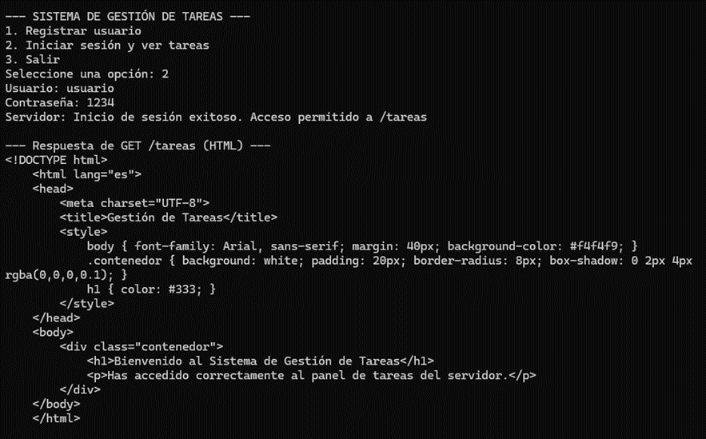
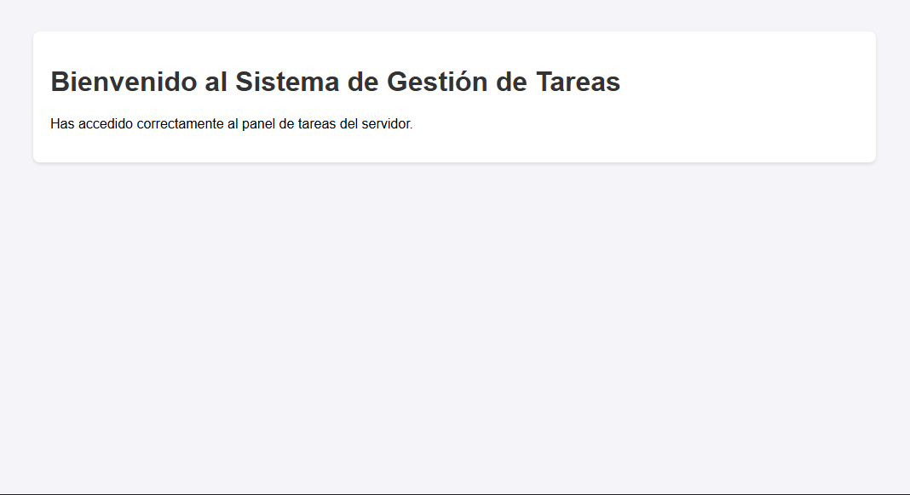

# PFO 2: Sistema de Gestión de Tareas con API y Base de Datos

Trabajo Práctico N° 2 para la materia **Programación sobre Redes**. 
Implementación de una arquitectura Cliente-Servidor mediante una API REST con Flask, persistencia en SQLite y protección de credenciales mediante hashing.

## Requisitos e Instalación

1. Asegurarse de tener Python instalado.
2. Instalar las librerías necesarias ejecutando en la terminal:
   ```bash
   pip install flask requests
   ```

## Instrucciones de Ejecución y Prueba

### 1. Iniciar el Servidor
Abrir una terminal en la carpeta del proyecto y ejecutar:
```bash
python servidor.py
```
El servidor creará automáticamente el archivo `usuarios.db` y quedará escuchando peticiones en `http://localhost:5000`.

### 2. Ejecutar el Cliente
Abrir una segunda terminal y ejecutar:
```bash
python cliente.py
```
Seguir las opciones del menú en consola para registrar un usuario, iniciar sesión y visualizar el HTML de bienvenida del endpoint `/tareas`. También se puede acceder a `http://localhost:5000/tareas` desde el navegador o probar los endpoints con Postman.

---

## Capturas de Pantalla de Pruebas Exitosas

### 1. Registro de usuario


### 2. Inicio de sesión


### 3. Acceso a tareas


---

## Respuestas Conceptuales

### 1. ¿Por qué hashear contraseñas?
En una arquitectura cliente-servidor, los datos están centralizados en el servidor. Si las contraseñas se guardaran en texto plano y la base de datos sufriera un acceso no autorizado o una filtración, todas las claves de los usuarios quedarían expuestas.

El *hashing* transforma la contraseña en una cadena de texto irreversible mediante una función matemática. Así, nadie puede ver la clave real en la base de datos: cuando el usuario intenta iniciar sesión, el servidor aplica el mismo hash a la contraseña ingresada y compara si ambos resultados coinciden.

### 2. Ventajas de usar SQLite en este proyecto
- **Sin servidor adicional (Serverless):** No requiere instalar ni configurar un motor de base de datos externo corriendo en segundo plano.
- **Integración nativa:** El módulo `sqlite3` ya viene incluido en Python, lo que simplifica la configuración y ejecución del proyecto en cualquier computadora.
- **Portabilidad:** Toda la base de datos se almacena en un único archivo local (`usuarios.db`), ideal para proyectos académicos, prototipos y pruebas locales rápidas.